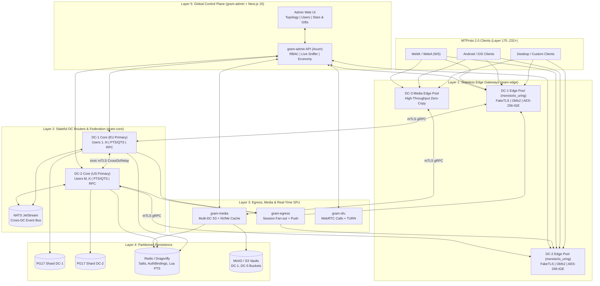
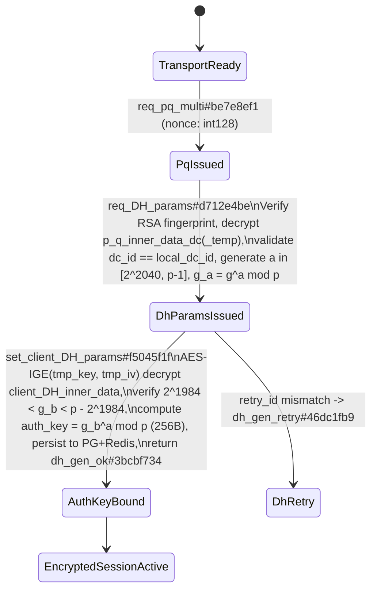
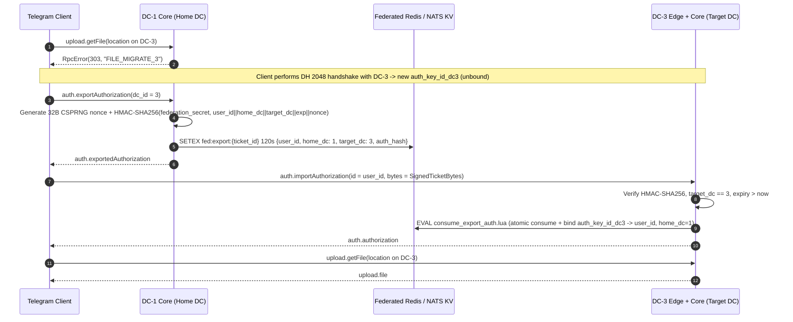
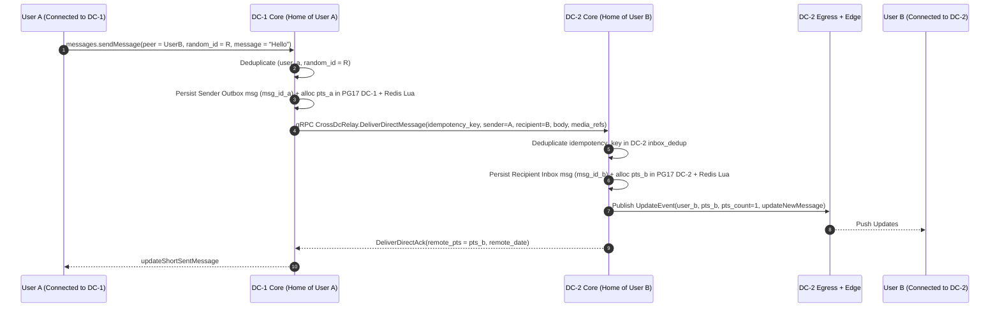

# shuzagram-server — Master Architecture & Implementation Blueprint

> **Document Status:** Phase 0 Master Architectural Specification (Production-Grade Blueprint)  
> **Target Compatibility:** MTProto 2.0 (Canonical TL Layer 232, Multi-Layer Profile Translation 170–232+)  
> **Target Runtime:** Rust (Edition 2024, `tokio` + `monoio`/`io_uring`) + Next.js 15 Control Plane  
> **Topology:** Federated Multi-DC (`DC-1` .. `DC-5+`) with Active-Active Edge Gateways, Home-DC Stateful Shards, mTLS `tonic` gRPC + NATS JetStream Bus

---

## Table of Contents

1. [Repository & Cargo Workspace Layout](#1-repository--cargo-workspace-layout)
2. [Zero-Copy MTProto 2.0 Pipeline (`mtproto-crypto` & `gram-edge`)](#2-zero-copy-mtproto-20-pipeline-mtproto-crypto--gram-edge)
3. [TL Compiler & Multi-Layer Translation Engine (`tl-compiler` & `tl-core`)](#3-tl-compiler--multi-layer-translation-engine-tl-compiler--tl-core)
4. [Multi-DC Topology, Routing & Federation Protocol](#4-multi-dc-topology-routing--federation-protocol)
5. [Inter-DC Protobuf Contracts (`proto/federation.proto`)](#5-inter-dc-protobuf-contracts-protofederationproto)
6. [State Synchronization Mathematics (`pts`, `qts`, `channel_pts`, `seq`)](#6-state-synchronization-mathematics-pts-qts-channel_pts-seq)
7. [Storage & Sharding Topology (PostgreSQL 17 DDL, Redis Lua, S3 Vault)](#7-storage--sharding-topology-postgresql-17-ddl-redis-lua-s3-vault)
8. [Control Plane Architecture (`gram-admin` + Next.js 15 Web UI)](#8-control-plane-architecture-gram-admin--nextjs-15-web-ui)
9. [Six-Phase Engineering Roadmap & Verification Suite](#9-six-phase-engineering-roadmap--verification-suite)

---

## 1. Repository & Cargo Workspace Layout

### 1.1 Directory Hierarchy

```text
shuzagram-server/
├── Cargo.toml                          # Workspace manifest, unified dependencies & release LTO profile
├── rust-toolchain.toml                 # Pinned Rust stable (Edition 2024), x86_64/aarch64 SIMD targets
├── proto/
│   └── federation.proto                # Inter-DC gRPC contracts (Relay, Auth, Channels, Media, Admin)
├── schemas/
│   ├── canonical_layer_232.tl          # Canonical MTProto + Telegram API TL schema (Layer 232)
│   ├── mtproto_transport.tl            # Transport/service constructors (resPQ, DH, msg_container, rpc_result)
│   └── profiles/                       # Per-layer constructor delta manifests (layers 170..231)
│       ├── layer_185.json
│       ├── layer_200.json
│       └── layer_220.json
├── migrations/                         # PostgreSQL 17 forward-only DDL migrations
│   ├── 0001_cluster_and_crypto.up.sql
│   ├── 0002_users_and_routing.up.sql
│   ├── 0003_auth_keys_and_sessions.up.sql
│   ├── 0004_dialogs_messages_updates.up.sql
│   ├── 0005_channels_and_forums.up.sql
│   ├── 0006_media_volumes.up.sql
│   ├── 0007_economy_stars_gifts.up.sql
│   └── 0008_admin_rbac_audit.up.sql
├── lua/                                # Atomic Redis / DragonflyDB state scripts
│   ├── validate_salt_and_msgid.lua
│   ├── alloc_pts_and_append.lua
│   ├── alloc_channel_pts.lua
│   └── consume_export_auth.lua
├── crates/
│   ├── mtproto-crypto/                 # AES-256-IGE (AES-NI/NEON), KDF v2, RSA-2048, DH-2048, Obfs2, FakeTLS
│   ├── tl-compiler/                    # Proc-macro + build-time .tl parser & Rust code generator
│   ├── tl-core/                        # Zero-copy TlRead/TlWrite traits, Layer 232 types, LayerTranslator
│   ├── gram-proto/                     # prost + tonic generated gRPC code & NATS JetStream envelopes
│   ├── gram-store/                     # Partition-aware sqlx PG17 pools, Redis Lua runner, S3/NVMe tier
│   ├── gram-edge/                      # Stateless MTProto TCP/WS/HTTP/FakeTLS gateway (monoio / tokio)
│   ├── gram-core/                      # Stateful DC router, 49 domain services, DC migration & federation
│   ├── gram-egress/                    # Real-time Update fan-out, getDifference, FCM/APNs/WebPush
│   ├── gram-media/                     # Multi-DC upload/download, file_reference HMAC, S3/CDN streaming
│   ├── gram-sfu/                       # 1:1 & Group Call WebRTC SFU + embedded STUN/TURN orchestrator
│   ├── gram-botapi/                    # HTTP Bot API gateway (8081) bridged to gram-core
│   ├── gram-admin/                     # Axum REST + WS/SSE Control Plane API, RBAC, Live RPC Sniffer
│   └── gram-loadtest/                  # Multi-DC MTProto 2.0 synthetic benchmark & chaos runner
├── web/
│   └── admin-ui/                       # Next.js 15 + TypeScript + TailwindCSS + shadcn/ui + React Flow
│       ├── src/config/nav.ts           # Single source of truth for Sidebar, Tabs, Routes & Permissions
│       ├── src/config/permissions.ts   # Typed RBAC rights synchronized with gram-admin
│       ├── src/app/                    # App Router pages (Topology, Users, Sessions, Economy, Sniffer)
│       └── package.json
├── deploy/
│   ├── docker/
│   │   ├── Dockerfile.rust             # Multi-stage hardened distroless/nonroot build (UID 10001)
│   │   ├── Dockerfile.admin-ui         # Static/standalone Next.js build
│   │   └── compose.multi-dc.yaml       # Reference 3-DC local cluster (PG17, Dragonfly, NATS, MinIO)
│   └── systemd/                        # Bare-metal Linux io_uring unit templates (LimitMEMLOCK=infinity)
└── docs/
    ├── MASTER_PLAN.md
    ├── MINDMAP.md
    └── MINDMAP.opml
```

### 1.2 Root Workspace Manifest (`Cargo.toml`)

```toml
[workspace]
resolver = "3"
members = [
    "crates/mtproto-crypto",
    "crates/tl-compiler",
    "crates/tl-core",
    "crates/gram-proto",
    "crates/gram-store",
    "crates/gram-edge",
    "crates/gram-core",
    "crates/gram-egress",
    "crates/gram-media",
    "crates/gram-sfu",
    "crates/gram-botapi",
    "crates/gram-admin",
    "crates/gram-loadtest",
]

[workspace.package]
version = "0.1.0"
edition = "2024"
rust-version = "1.85"
license = "GPL-2.0-only"

[workspace.dependencies]
tokio = { version = "1.43", features = ["full", "tracing"] }
monoio = { version = "0.2", features = ["uring", "sync", "tokio-compat"] }
bytes = "1.10"
zerocopy = { version = "0.8", features = ["derive", "simd"] }
bytemuck = { version = "1.21", features = ["derive"] }
aes = "0.8"
ctr = "0.9"
sha1 = "0.10"
sha2 = { version = "0.10", features = ["asm"] }
hmac = "0.12"
rsa = "0.9"
num-bigint-dig = "0.8"
rand = "0.8"
crc32fast = "1.4"
flate2 = { version = "1.1", features = ["zlib-ng"], default-features = false }
tonic = { version = "0.12", features = ["tls", "tls-roots", "gzip", "zstd"] }
prost = "0.13"
async-nats = "0.39"
sqlx = { version = "0.8", features = ["runtime-tokio-rustls", "postgres", "uuid", "time", "json"] }
deadpool-redis = { version = "0.18", features = ["rt_tokio_1"] }
aws-sdk-s3 = "1.74"
axum = { version = "0.8", features = ["ws", "macros", "json"] }
tower = "0.5"
tower-http = { version = "0.6", features = ["cors", "trace", "compression-zstd"] }
dashmap = "6.1"
crossbeam-queue = "0.3"
parking_lot = "0.12"
tokio-tungstenite = "0.26"
webrtc = "0.12"
serde = { version = "1.0", features = ["derive"] }
serde_json = "1.0"
thiserror = "2.0"
tracing = "0.1"
metrics = "0.24"
metrics-exporter-prometheus = "0.16"

[profile.release]
opt-level = 3
lto = "thin"
codegen-units = 1
panic = "abort"
strip = "symbols"
```

---

## 2. Zero-Copy MTProto 2.0 Pipeline (`mtproto-crypto` & `gram-edge`)

### 2.1 System Architecture Overview



### 2.2 Transport Framing & Obfuscation Rules

Every incoming TCP or WebSocket stream starts in `DetectingTransport` state, inspecting the initial bytes in a pre-allocated 64 KiB `BytesMut` slab:

| Transport Variant | Magic / Detection Bytes | Length Header Encoding | Trailer / Padding | Quick-Ack Support |
| :--- | :--- | :--- | :--- | :--- |
| **Abridged** | First byte `0xef` | `1 byte` (`0x01..0x7e` = words `len*4`), or `0x7f` + `3-byte LE` words (`len*4`) | None | High bit `0x80` on length byte (`4-byte` LE ack token response) |
| **Intermediate** | First 4 bytes `0xeeeeeeee` | `4-byte u32 LE` exact byte length | None | High bit `0x80000000` on `u32` length |
| **Padded Intermediate** | First 4 bytes `0xdddddddd` | `4-byte u32 LE` byte length (payload + `0..15` random pad bytes) | `0..15` random bytes stripped after inner length read | High bit `0x80000000` on `u32` length |
| **Full TCP** | First 4 bytes not matching above & byte 4..8 == `0x00000000` (`seq_no = 0`) | `len: u32 LE` (total including 12B framing) + `seq_no: i32 LE` | `crc32: u32 LE` (IEEE 802.3 over `len \|\| seq_no \|\| body`) | Via 4-byte negative length frames |
| **Obfuscated2** | 64-byte random header (not HTTP `POST `/`GET `, not TLS `0x16 0x03`) | `rx_key = hdr[8..40]`, `rx_iv = hdr[40..56]`; `tx_key = rev(hdr[8..56])[0..32]`, `tx_iv = rev(hdr[8..56])[32..48]`. Decrypt `hdr[56..64]` via AES-256-CTR; bytes `56..60` yield inner tag (`0xefefefef`, `0xeeeeeeee`, or `0xdddddddd`) | Inner transport framing | Inherited from inner tag |
| **Fake-TLS (`ee`/`dd` secret)** | `0x16 0x03 0x01` + `u16 BE len` (TLS 1.2/1.3 ClientHello) | Verify `HMAC-SHA256(secret[0..16], client_hello_with_zeroed_random)` == `client_random[0..32]` (`[28..32] ^ timestamp`), check SNI matches configured `fronting_domain`, check replay cache for `client_random`. Emit synthetic `ServerHello + ChangeCipherSpec + ApplicationData` record framing (`0x17 0x03 0x03 + u16 BE len`), then transition into Obfuscated2 | TLS 1.3 ApplicationData records (`max 16384B` per record) | Inherited from inner tag |

### 2.3 Zero-Copy Wire Structs & Memory Layout (`crates/mtproto-crypto` & `crates/gram-edge`)

```rust
use bytes::BytesMut;
use zerocopy::{FromBytes, Immutable, IntoBytes, KnownLayout, LittleEndian, I32, I64, U32};

/// Unencrypted MTProto frame header (auth_key_id == 0): 20 bytes total.
#[repr(C, packed)]
#[derive(Copy, Clone, Debug, FromBytes, IntoBytes, KnownLayout, Immutable)]
pub struct UnencryptedFrameHeader {
    pub auth_key_id: I64<LittleEndian>, // Must equal 0
    pub message_id: I64<LittleEndian>,  // Unix timestamp * 2^32 (mod 4 == 0 from client)
    pub message_data_length: U32<LittleEndian>,
}

/// Encrypted MTProto 2.0 outer envelope header: 24 bytes (precedes 16-byte aligned ciphertext).
#[repr(C, packed)]
#[derive(Copy, Clone, Debug, FromBytes, IntoBytes, KnownLayout, Immutable)]
pub struct EncryptedOuterHeader {
    pub auth_key_id: I64<LittleEndian>, // Lower 64 bits of SHA1(auth_key)
    pub msg_key: [u8; 16],              // SHA256(auth_key[88+x..120+x] || plaintext_padded)[8..24]
}

/// Decrypted MTProto 2.0 inner header: 32 bytes (followed by payload + 12..1024 bytes random padding).
#[repr(C, packed)]
#[derive(Copy, Clone, Debug, FromBytes, IntoBytes, KnownLayout, Immutable)]
pub struct DecryptedInnerHeader {
    pub salt: I64<LittleEndian>,
    pub session_id: I64<LittleEndian>,
    pub message_id: I64<LittleEndian>,
    pub seq_no: I32<LittleEndian>,
    pub message_data_length: U32<LittleEndian>,
}

#[derive(Copy, Clone, Debug, Eq, PartialEq)]
pub enum Direction {
    ClientToServer, // x = 0
    ServerToClient, // x = 8
}

impl Direction {
    #[inline(always)]
    pub const fn x_offset(self) -> usize {
        match self {
            Self::ClientToServer => 0,
            Self::ServerToClient => 8,
        }
    }
}

/// Hardware-accelerated MTProto 2.0 Key Derivation & In-Place AES-256-IGE Engine.
pub trait MtProtoCipher {
    /// Derives (aes_key, aes_iv) per MTProto 2.0 specification:
    /// sha256_a = SHA256(msg_key || auth_key[x .. x+36])
    /// sha256_b = SHA256(auth_key[40+x .. 76+x] || msg_key)
    /// aes_key  = sha256_a[0..8] || sha256_b[8..24] || sha256_a[24..32]
    /// aes_iv   = sha256_b[0..8] || sha256_a[8..24] || sha256_b[24..32]
    fn derive_key_iv(
        auth_key: &[u8; 256],
        msg_key: &[u8; 16],
        dir: Direction,
    ) -> ([u8; 32], [u8; 32]);

    /// Decrypts `ciphertext` in-place (must be a multiple of 16 bytes) and verifies `msg_key`
    /// in constant time against `SHA256(auth_key[88+x..120+x] || plaintext_with_padding)[8..24]`.
    fn decrypt_ige_in_place<'a>(
        auth_key: &[u8; 256],
        msg_key: &[u8; 16],
        ciphertext: &'a mut [u8],
    ) -> Result<(&'a DecryptedInnerHeader, &'a [u8]), CryptoError>;

    /// Encrypts `[DecryptedInnerHeader || payload || 12..1024B random padding]` in-place inside `slab`,
    /// writing `EncryptedOuterHeader` into the reserved 24-byte prefix without reallocating.
    fn encrypt_ige_in_place(
        auth_key_id: i64,
        auth_key: &[u8; 256],
        slab: &mut BytesMut,
        rng: &mut impl rand::CryptoRng,
    ) -> Result<(), CryptoError>;
}
```

### 2.4 In-Place AES-256-IGE Formula (`mtproto-crypto`)

AES-256-IGE (Infinite Garble Extension) splits the 32-byte `aes_iv` into $c_0 = \text{iv}[0..16]$ (initial previous ciphertext block) and $m_0 = \text{iv}[16..32]$ (initial previous plaintext block). For 16-byte blocks $i = 1 \dots N$:

* **Decryption (in-place over `&mut [u8]` using `aes` hardware intrinsics):**
  $$p_i = \text{AES}_{256}^{-1}(k,\; c_i \oplus m_{i-1}) \oplus c_{i-1}$$
  Because $c_{i-1}$ and $m_{i-1}$ are kept in two `u128` / `__m128i` CPU registers (`prev_cipher`, `prev_plain`), each 16-byte slice of `BytesMut` is overwritten in-place with zero heap allocations.
* **Security Invariants Enforced Before TL Dispatch:**
  1. `ciphertext.len() >= 32 && ciphertext.len() % 16 == 0`.
  2. Constant-time `subtle::ConstantTimeEq` comparison of computed `msg_key` vs outer `msg_key` (prevents timing/padding oracle attacks per Telegram security guidelines; on mismatch, drop connection silently without sending TL error).
  3. `padding_len = ciphertext.len() - 32 - inner.message_data_length as usize`; enforce `12 <= padding_len <= 1024` and `inner.message_data_length % 4 == 0`.
  4. `msg_id` parity & clock window: `msg_id & 3 == 0`, `| (msg_id >> 32) - unix_now | <= 300s` (if outside window, emit `bad_msg_notification#a7eff811` error code `16` or `17`; if replay hit in 128-slot sliding bitmap, drop silently; if `salt` not in `[prev_salt, curr_salt, next_salt]`, emit `bad_server_salt#edab447b` error code `48` with `curr_salt`).

### 2.5 Unencrypted Diffie-Hellman 2048-Bit Handshake State Machine



* **DC Affinity Check during DH:** `p_q_inner_data_dc#a9f55f95` and `p_q_inner_data_temp_dc#56fddf88` carry `dc: int` (signed `i32`, where `1..5` = production DCs and `10000 + dc` or negative IDs = test/media DCs). `gram-edge` verifies `inner.dc.abs() == edge_local_dc_id` so an AuthKey is cryptographically bound to the exact DC where it was negotiated.

---

## 3. TL Compiler & Multi-Layer Translation Engine (`tl-compiler` & `tl-core`)

### 3.1 Build-Time Schema Codegen (`crates/tl-compiler`)

`tl-compiler` parses `schemas/canonical_layer_232.tl`, `schemas/mtproto_transport.tl`, and `schemas/profiles/layer_*.json` into deterministic zero-allocation Rust modules:

1. **Zero-Copy Reader & Writer Traits (`crates/tl-core`):**

```rust
use bytes::BytesMut;

#[derive(Debug, Copy, Clone, Eq, PartialEq)]
pub enum TlError {
    UnexpectedEof { needed: usize, remaining: usize },
    UnknownConstructor { id: u32, context: &'static str },
    InvalidUtf8,
    InvalidPadding,
    VectorLengthOverflow { count: u32 },
    WrapperDepthExceeded { max_depth: u8 },
}

pub trait TlRead<'a>: Sized {
    fn tl_read(buf: &mut &'a [u8]) -> Result<Self, TlError>;
}

pub trait TlWrite {
    fn tl_serialized_len(&self) -> usize;
    fn tl_write(&self, out: &mut BytesMut);
}

/// Zero-copy TL byte slice (`bytes` in TL: 1-byte len < 254, or 0xfe + 3-byte LE len, 4-byte padded).
#[derive(Copy, Clone, Debug, Eq, PartialEq)]
pub struct TlBytes<'a>(pub &'a [u8]);

/// Zero-copy UTF-8 TL string (`string` in TL).
#[derive(Copy, Clone, Debug, Eq, PartialEq)]
pub struct TlStr<'a>(pub &'a str);

/// Zero-copy lazy TL `Vector<T>` iterator that validates header `0x1cb5c415` + element count
/// and decodes elements on demand without allocating a `Vec<T>` on the heap.
#[derive(Copy, Clone, Debug)]
pub struct TlSliceIter<'a, T> {
    remaining_items: u32,
    buf: &'a [u8],
    _marker: core::marker::PhantomData<T>,
}
```

2. **Multi-Layer Compatibility & Downgrade/Upgrade Pipeline:**
   * Every session stores `negotiated_layer: u16` (recorded when `invokeWithLayer#da9b0d0d { layer, query }` + `initConnection#c1cd5ea9` executes).
   * Internally, `gram-core` operates strictly on **Canonical Layer 232** domain and TL structs.
   * On **Ingress** (when `negotiated_layer < 232`), `LayerAdapterRegistry::decode_rpc<'a>(layer, buf)` matches older constructor CRC32 IDs (e.g., `messages.sendMessage` from Layer 185 vs Layer 232) and populates default values for newly added optional flag bits.
   * On **Egress** (both RPC `rpc_result#f35c6d01` responses and pushed `Updates` in `gram-egress`), `LayerAdapterRegistry::encode_for_layer(layer, &canonical_obj, &mut out_buf)` emits the exact wire layout expected by that session's `negotiated_layer` AND `ClientQuirkProfile` (`Desktop`, `Android`, `Ios`, `Web`).

---

## 4. Multi-DC Topology, Routing & Federation Protocol

### 4.1 Data Center Roles (`DC-1` .. `DC-5+`)

| DC ID | Default Region / Role | Hosted State | `DcOption` Flags |
| :--- | :--- | :--- | :--- |
| **DC-1** | Primary Americas / Default Entry | Bootstrap config, Home Users shard 1, Channels shard 1, Media Vault 1 | `default` (`static`, IPv4 + IPv6, WS + TCP + FakeTLS) |
| **DC-2** | Primary Europe / CIS | Home Users shard 2, Channels shard 2, Media Vault 2 | `static`, IPv4 + IPv6, WS + TCP + FakeTLS |
| **DC-3** | Dedicated Media & Heavy Assets | High-density S3/NVMe Vaults (Stickers, Collectible Gift `.tgs`, Public VOD) | `media_only` optional or full hybrid |
| **DC-4** | Europe West / High-Density Shard | Home Users shard 4, Supergroups shard 4, Media Vault 4 | `static`, IPv4 + IPv6 |
| **DC-5** | APAC / Singapore | Home Users shard 5, Channels shard 5, Media Vault 5 | `static`, IPv4 + IPv6 |
| **DC-203+** | Optional Edge CDN Nodes | Stateless encrypted media cache (`upload.getCdnFile`) | `cdn = true` |

### 4.2 `help.getConfig` Dynamic Distribution

`gram-core` serves `help.getConfig#c4f9186b` from an in-memory `ArcSwap<ClusterConfigSnapshot>` refreshed instantaneously via NATS `admin.config.updated` whenever an operator edits DC topology in the Control Panel:

* Emits `config#cc1a241e` with `this_dc = local_dc_id`, `dc_options: Vector<DcOption>`, `dc_txt_domain_name`, `chat_size_max`, `megagroup_size_max`, `forwarded_count_max`, `autoupdate_url_prefix`, and configurable link prefixes (`me_url_prefix` loaded from `PUBLIC_LINK_DOMAIN`, never hardcoded).
* When an operator drains a DC or rotates an Edge IP/port/FakeTLS secret, `gram-egress` broadcasts `updateConfig#a229dd06` to connected sessions so clients hot-reload `DcOption` tables without restarting.

### 4.3 `303 *_MIGRATE_X` Decision Matrix

| Client Context | Invoked RPC Category | Routing Lookup Result | Server Response / Action |
| :--- | :--- | :--- | :--- |
| Unauthenticated (`user_id == None`) on `DC-A` | `auth.sendCode(phone_number)` | `global_directory_routing` maps `phone_number` (existing user or prefix policy) -> `DC-B` (`B != A`) | Return `rpc_error#2144ca19 { error_code: 303, error_message: "PHONE_MIGRATE_B" }` |
| Unauthenticated (`user_id == None`) on `DC-A` | `auth.signIn`, `auth.signUp`, `auth.checkPassword`, `auth.importBotAuthorization` | Target account's `home_dc_id == B` (`B != A`) | Return `rpc_error { error_code: 303, error_message: "PHONE_MIGRATE_B" }` or `"USER_MIGRATE_B"` |
| Authenticated on `DC-A`, `auth_key` bound via `importAuthorization` (`home_dc_id == B`, `B != A`) | User-home RPC (`messages.*`, `account.*`, `contacts.*`, `updates.getState`) | Session is foreign-bound (`local_dc != home_dc`) and client mistakenly sent main RPC to media/foreign socket | Return `rpc_error { error_code: 303, error_message: "USER_MIGRATE_B" }` |
| Authenticated on `DC-A` (`home_dc_id == A`) | `upload.getFile` / `upload.getWebFile` with `location` pointing to `DC-C` (`C != A`) | Inspect `file_reference` header `dc_id == C` | If `proxy_small_files` disabled or `size > 1 MiB`: return `rpc_error { error_code: 303, error_message: "FILE_MIGRATE_C" }`. Client opens parallel connection to `DC-C`, runs `export/importAuthorization`, and downloads directly from `DC-C` |
| Live Admin Home-DC Migration (`DC-A -> DC-B` completed) | Any RPC on old `DC-A` socket | `users_routing_cache` shows `home_dc_id == B` (`epoch > session.dc_epoch`) | Return `rpc_error { error_code: 303, error_message: "USER_MIGRATE_B" }` |

### 4.4 Cross-DC Authorization (`auth.exportAuthorization` & `auth.importAuthorization`)



**Binary Layout of `SignedTicketBytes` (76 bytes):**

```text
Offset  Size  Field
0..1    1B    version = 0x01
1..3    2B    home_dc_id (u16 LE)
3..5    2B    target_dc_id (u16 LE)
5..13   8B    user_id (i64 LE)
13..21  8B    issued_at_ms (i64 LE)
21..29  8B    expires_at_ms (i64 LE, default +120_000 ms)
29..44  15B   ticket_nonce (120-bit CSPRNG unique ID)
44..76  32B   hmac_sha256 (keyed with cluster `FEDERATION_HMAC_KEY` rotated via Control Plane)
```

### 4.5 Cross-DC Private & Group/Channel Message Delivery Flow



* **Supergroups & Broadcast Channels (`channel_id`):** Every channel has an immutable `origin_dc_id` stored in `global_directory_routing` (assigned to the creator's `home_dc_id` at `channels.createChannel`).
  * Any member on `DC-X` posting to a channel hosted on `DC-1` has their `messages.sendMessage` transparently forwarded by `DC-X Core` over mTLS `ChannelFederation.PublishChannelMessage` to `DC-1 Core`.
  * `DC-1 Core` atomically allocates `channel_pts` (`1, 2, 3...`), persists the canonical channel message once in `DC-1` PostgreSQL, and publishes a single `ChannelPtsEvent` on NATS JetStream subject `fed.channel.{channel_id}.updates`.
  * Only DCs that currently hold active online subscriber sessions for `{channel_id}` subscribe to that NATS subject, fanning out `updateNewChannelMessage#62ba04d9` locally with $O(\text{DCs})$ inter-DC bandwidth instead of $O(\text{subscribers})$ cross-DC RPCs.

---

## 5. Inter-DC Protobuf Contracts (`proto/federation.proto`)

```protobuf
syntax = "proto3";

package gramsrv.federation.v1;

option optimize_for = SPEED;

// ============================================================================
// Common Primitives
// ============================================================================

message PeerRef {
  enum Kind {
    KIND_UNSPECIFIED = 0;
    KIND_USER = 1;
    KIND_CHAT = 2;
    KIND_CHANNEL = 3;
  }
  Kind kind = 1;
  int64 id = 2;
  int64 access_hash = 3;
  uint32 home_dc_id = 4;
}

message EntityMinSnapshot {
  int64 id = 1;
  uint32 home_dc_id = 2;
  int64 access_hash_seed = 3;
  string username = 4;
  string first_name = 5;
  string last_name = 6;
  string phone = 7;
  uint64 flags_bitmask = 8; // verified, premium, bot, scam, fake
  int64 photo_id = 9;
  uint32 photo_dc_id = 10;
}

message SerializedTlPayload {
  uint32 canonical_layer = 1; // Always 232 internally
  uint32 constructor_id = 2;
  bytes tl_bytes = 3;
}

// ============================================================================
// 1. Cross-DC Direct & Basic-Group Relay
// ============================================================================

service CrossDcRelay {
  rpc DeliverDirectMessage(DeliverDirectMessageRequest) returns (DeliverDirectMessageResponse);
  rpc DeliverMessageEdit(DeliverMessageEditRequest) returns (DeliverMutationAck);
  rpc DeliverMessageDelete(DeliverMessageDeleteRequest) returns (DeliverMutationAck);
  rpc DeliverReadHistory(DeliverReadHistoryRequest) returns (DeliverMutationAck);
  rpc DeliverTypingAction(DeliverTypingActionRequest) returns (EmptyAck);
  rpc ResolvePeerProfile(ResolvePeerProfileRequest) returns (ResolvePeerProfileResponse);
}

message DeliverDirectMessageRequest {
  string idempotency_key = 1; // "{origin_dc}:{sender_id}:{random_id}"
  uint32 origin_dc_id = 2;
  uint32 target_dc_id = 3;
  EntityMinSnapshot sender = 4;
  int64 recipient_user_id = 5;
  int64 random_id = 6;
  int32 date_unix = 7;
  string message_text = 8;
  SerializedTlPayload entities_tl = 9;
  SerializedTlPayload media_tl = 10;
  SerializedTlPayload reply_header_tl = 11;
  SerializedTlPayload forward_header_tl = 12;
  int32 ttl_period = 13;
  uint64 message_flags = 14;
}

message DeliverDirectMessageResponse {
  int32 recipient_msg_id = 1;
  int32 recipient_pts = 2;
  int32 date_unix = 3;
}

message DeliverMessageEditRequest {
  string idempotency_key = 1;
  uint32 origin_dc_id = 2;
  int64 sender_user_id = 3;
  int64 recipient_user_id = 4;
  int64 random_id = 5;
  int32 edit_date_unix = 6;
  string new_text = 7;
  SerializedTlPayload entities_tl = 8;
  SerializedTlPayload media_tl = 9;
}

message DeliverMessageDeleteRequest {
  string idempotency_key = 1;
  uint32 origin_dc_id = 2;
  int64 actor_user_id = 3;
  int64 target_user_id = 4;
  repeated int64 message_random_ids = 5;
  bool revoke_for_both = 6;
}

message DeliverReadHistoryRequest {
  uint32 origin_dc_id = 1;
  int64 reader_user_id = 2;
  int64 peer_user_id = 3;
  int32 max_date_or_seq = 4;
}

message DeliverTypingActionRequest {
  uint32 origin_dc_id = 1;
  int64 actor_user_id = 2;
  int64 target_user_id = 3;
  SerializedTlPayload send_message_action_tl = 4;
}

message DeliverMutationAck {
  bool applied = 1;
  int32 new_pts = 2;
}

message EmptyAck {}

message ResolvePeerProfileRequest {
  PeerRef peer = 1;
  int64 requester_user_id = 2;
}

message ResolvePeerProfileResponse {
  bool found = 1;
  EntityMinSnapshot entity = 2;
  SerializedTlPayload full_entity_tl = 3;
}

// ============================================================================
// 2. Cross-DC Auth & Home-DC Migration Federation
// ============================================================================

service AuthFederation {
  rpc VerifyExportedAuth(VerifyExportedAuthRequest) returns (VerifyExportedAuthResponse);
  rpc NotifyRemoteSessionTerminated(SessionRevokeNotice) returns (EmptyAck);
  rpc MigrateUserHomeDc(MigrateUserHomeDcRequest) returns (MigrateUserHomeDcResponse);
}

message VerifyExportedAuthRequest {
  uint32 requesting_dc_id = 1;
  int64 user_id = 2;
  bytes signed_ticket_bytes = 3;
  int64 target_auth_key_id = 4;
}

message VerifyExportedAuthResponse {
  bool valid = 1;
  uint32 home_dc_id = 2;
  uint64 dc_epoch = 3;
  EntityMinSnapshot user_snapshot = 4;
}

message SessionRevokeNotice {
  int64 user_id = 1;
  repeated int64 revoked_auth_key_ids = 2;
  bool revoke_all_except_hash = 3;
  int64 keep_hash = 4;
}

message MigrateUserHomeDcRequest {
  string migration_job_id = 1;
  int64 user_id = 2;
  uint32 source_dc_id = 3;
  uint32 dest_dc_id = 4;
  uint64 new_dc_epoch = 5;
  bytes zstd_user_bundle = 6; // Atomic snapshot of user row, dialogs, recent messages, stars, pts
}

message MigrateUserHomeDcResponse {
  bool committed = 1;
  uint64 active_dc_epoch = 2;
  int32 restored_pts = 3;
}

// ============================================================================
// 3. Supergroup & Channel Origin-DC Federation
// ============================================================================

service ChannelFederation {
  rpc PublishChannelMessage(PublishChannelMessageRequest) returns (PublishChannelMessageResponse);
  rpc FetchChannelDifference(FetchChannelDifferenceRequest) returns (FetchChannelDifferenceResponse);
  rpc MutateChannelMembership(MutateChannelMembershipRequest) returns (MutateChannelMembershipResponse);
}

message PublishChannelMessageRequest {
  string idempotency_key = 1;
  uint32 caller_dc_id = 2;
  int64 channel_id = 3;
  EntityMinSnapshot author = 4;
  int64 random_id = 5;
  string text = 6;
  SerializedTlPayload entities_tl = 7;
  SerializedTlPayload media_tl = 8;
  int32 reply_to_msg_id = 9;
  int32 top_topic_id = 10;
}

message PublishChannelMessageResponse {
  int32 channel_msg_id = 1;
  int32 channel_pts = 2;
  int32 channel_pts_count = 3;
  int32 date_unix = 4;
}

message FetchChannelDifferenceRequest {
  int64 channel_id = 1;
  int64 requester_user_id = 2;
  int32 from_pts = 3;
  int32 limit = 4;
}

message FetchChannelDifferenceResponse {
  bool is_final = 1;
  int32 latest_pts = 2;
  repeated SerializedTlPayload new_messages_tl = 3;
  repeated SerializedTlPayload other_updates_tl = 4;
}

message MutateChannelMembershipRequest {
  int64 channel_id = 1;
  int64 actor_user_id = 2;
  int64 target_user_id = 3;
  enum Action {
    ACTION_UNSPECIFIED = 0;
    ACTION_JOIN = 1;
    ACTION_LEAVE = 2;
    ACTION_BAN = 3;
    ACTION_PROMOTE = 4;
  }
  Action action = 4;
  SerializedTlPayload rights_tl = 5;
}

message MutateChannelMembershipResponse {
  bool ok = 1;
  int32 channel_pts = 2;
}

// ============================================================================
// 4. Multi-DC Media Router
// ============================================================================

service MediaRouter {
  rpc StreamFileChunk(StreamFileChunkRequest) returns (StreamFileChunkResponse);
  rpc VerifyMediaReference(VerifyMediaReferenceRequest) returns (VerifyMediaReferenceResponse);
}

message StreamFileChunkRequest {
  uint32 storage_dc_id = 1;
  int64 volume_id = 2;
  int64 file_id = 3;
  int64 offset = 4;
  int32 limit = 5;
  bytes file_reference = 6;
}

message StreamFileChunkResponse {
  bytes chunk_bytes = 1;
  string mime_type = 2;
  int32 mtime_unix = 3;
  int64 total_size = 4;
}

message VerifyMediaReferenceRequest {
  bytes file_reference = 1;
  int64 file_id = 2;
}

message VerifyMediaReferenceResponse {
  bool valid = 1;
  uint32 owner_dc_id = 2;
}

// ============================================================================
// 5. Control Plane & Node Telemetry Contract
// ============================================================================

service AdminControl {
  rpc GetNodeHealth(EmptyAck) returns (NodeHealthReport);
  rpc PushClusterConfig(ClusterConfigPush) returns (EmptyAck);
  rpc SetRpcSnifferFilter(SnifferFilterSpec) returns ( stream DecodedRpcTraceEvent );
  rpc ForceDisconnectAuthKey(ForceDisconnectRequest) returns (EmptyAck);
}

message NodeHealthReport {
  string node_id = 1;
  string role = 2; // "edge", "core", "egress", "media", "sfu"
  uint32 dc_id = 3;
  uint64 active_connections = 4;
  uint64 inflight_rpcs = 5;
  double cpu_usage_pct = 6;
  uint64 rss_bytes = 7;
  map<uint32, uint32> inter_dc_rtt_micros = 8;
  uint64 uptime_seconds = 9;
}

message ClusterConfigPush {
  uint64 config_version = 1;
  bytes serialized_config_json = 2;
  bool broadcast_update_config = 3;
}

message SnifferFilterSpec {
  uint32 sample_rate_per_myriad = 1; // 1..10000 (10000 = 100% for targeted user_id)
  int64 filter_user_id = 2;          // 0 = any
  uint32 filter_dc_id = 3;           // 0 = any
  uint32 filter_constructor_id = 4;  // 0 = any
  bool errors_only = 5;
}

message DecodedRpcTraceEvent {
  uint64 trace_id = 1;
  int64 timestamp_micros = 2;
  uint32 dc_id = 3;
  string edge_node_id = 4;
  int64 user_id = 5;
  int64 auth_key_id = 6;
  uint32 client_layer = 7;
  uint32 constructor_id = 8;
  string method_name = 9;
  uint32 duration_micros = 10;
  int32 rpc_error_code = 11; // 0 = OK
  string rpc_error_message = 12;
  string payload_preview_json = 13;
}

message ForceDisconnectRequest {
  int64 auth_key_id = 1;
  uint32 dc_id = 2;
}
```

---

## 6. State Synchronization Mathematics (`pts`, `qts`, `channel_pts`, `seq`)

Telegram clients reject or refetch state if `pts` / `qts` / `seq` monotonicity is violated by even a single integer. `shuzagram-server` enforces four mathematical invariants across all DCs:

### 6.1 Domain Partitioning of State Counters

1. **Account `pts` (Persistent Event Sequence):**
   * Scoped strictly to `(home_dc_id, user_id)`. Never generated on a foreign DC.
   * Increments by `pts_count >= 1` for every persistent account mutation: `updateNewMessage`, `updateDeleteMessages`, `updateEditMessage`, `updateReadHistoryInbox`, `updateReadHistoryOutbox`, `updateFolderPeers`, `updateWebPage`.
2. **Secret Chat `qts` (Queue Sequence):**
   * Scoped to `(home_dc_id, user_id)` with ephemeral encrypted payloads (`updateNewEncryptedMessage#12bcbd9a`) retained only until acknowledged via `messages.receivedQueue#55a5bb66(max_qts)`.
3. **Channel / Supergroup `channel_pts`:**
   * Scoped strictly to `(origin_dc_id, channel_id)`. Completely independent of individual subscribers' personal `pts`, allowing 200,000-member supergroups to advance `channel_pts` in `O(1)` time without touching `200,000` user rows.
4. **Session `seq` (Transient Delivery Sequence):**
   * Scoped to `(edge_dc_id, auth_key_id, session_id)` inside `gram-egress`.
   * Content-related updates carrying a `seq` requirement increment `seq` by 1 (`seq = current_seq + 1`), while transient notifications (`updateUserStatus`, `updateUserTyping`) carry `seq = 0`.

### 6.2 Client Gap-Detection Equations & Server Ordering Guarantee

When a client holds local state $P_{\text{local}}$ and receives an update carrying $(P_{\text{new}}, C)$ where $C = \text{pts\_count}$:

$$\Delta = P_{\text{local}} + C - P_{\text{new}}$$

* **Case $\Delta = 0$ ($P_{\text{local}} + C == P_{\text{new}}$):** Contiguous transition. Client applies update immediately and sets $P_{\text{local}} \leftarrow P_{\text{new}}$.
* **Case $\Delta > 0$ ($P_{\text{local}} + C > P_{\text{new}}$):** Duplicate / already-applied event. Client discards silently.
* **Case $\Delta < 0$ ($P_{\text{local}} + C < P_{\text{new}}$):** Gap detected! Client starts a 500 ms gap timer; if missing updates `(P_local + 1 .. P_new - C)` do not arrive in order, client invokes `updates.getDifference(pts = P_local, date, qts)`.

**Preventing Out-of-Order Commit Holes in PostgreSQL + Redis:**
If Worker Thread 1 allocates `pts = 101` in Redis and Worker Thread 2 allocates `pts = 102`, and Thread 2 commits to PostgreSQL *before* Thread 1, a concurrent `updates.getDifference(pts = 100)` query against PostgreSQL would see `[102]` without `[101]`, permanently skipping `101`!

`shuzagram-server` eliminates this race completely via **Dual-Write Ring + Contiguous High-Water Mark (`contiguous_pts`)**:
1. `alloc_pts_and_append.lua` atomically increments `pts:seq:{dc}:{uid}` AND pushes the serialized `pts_update` into a bounded Redis ZSET `pts:ring:{dc}:{uid}` (scored by `pts`, retaining the last 2,048 updates for 24 hours) in the **exact same single-threaded Lua execution**.
2. `updates.getDifference(from_pts)` serves recent deltas (`latest_pts - from_pts <= 2048`) **directly from the Redis ZSET `pts:ring:{dc}:{uid}`**, where allocation order and visibility order are 100% identical ($O(\log N)$ zero-PG-hit fast path!).
3. An asynchronous micro-batch writer flushes committed `pts_updates` rows to PostgreSQL 17 `pts_updates` in strict ascending `pts` order for cold `getDifference` queries older than 2,048 events.

---

## 7. Storage & Sharding Topology (PostgreSQL 17 DDL, Redis Lua, S3 Vault)

### 7.1 PostgreSQL 17 Partitioned Schema (`migrations/0001..0008.up.sql`)

```sql
-- ============================================================================
-- 0001_cluster_and_crypto.up.sql
-- ============================================================================
CREATE TABLE dc_clusters (
    dc_id               SMALLINT PRIMARY KEY CHECK (dc_id BETWEEN 1 AND 32000),
    region_code         VARCHAR(32) NOT NULL,
    display_name        VARCHAR(64) NOT NULL,
    status              VARCHAR(16) NOT NULL DEFAULT 'active'
                        CHECK (status IN ('active', 'draining', 'readonly', 'offline')),
    is_default_entry    BOOLEAN NOT NULL DEFAULT FALSE,
    is_media_only       BOOLEAN NOT NULL DEFAULT FALSE,
    is_cdn              BOOLEAN NOT NULL DEFAULT FALSE,
    endpoints_json      JSONB NOT NULL DEFAULT '[]'::jsonb, -- [{ip, ipv6, port, tcpo_only, secret_hex}]
    updated_at          TIMESTAMPTZ NOT NULL DEFAULT NOW()
);

CREATE TABLE rsa_keys (
    fingerprint         BIGINT PRIMARY KEY, -- Lower 64 bits of SHA1(TL(rsa_public_key))
    public_pem          TEXT NOT NULL,
    private_pem_enc     BYTEA NOT NULL,     -- Encrypted at rest with KMS / master key
    status              VARCHAR(16) NOT NULL DEFAULT 'active'
                        CHECK (status IN ('active', 'deprecated', 'revoked')),
    created_at          TIMESTAMPTZ NOT NULL DEFAULT NOW(),
    expires_at          TIMESTAMPTZ
);

CREATE TABLE dh_configs (
    version             INTEGER PRIMARY KEY,
    prime_p             BYTEA NOT NULL CHECK (octet_length(prime_p) = 256),
    generator_g         INTEGER NOT NULL CHECK (generator_g IN (2, 3, 4, 5, 6, 7)),
    is_current          BOOLEAN NOT NULL DEFAULT FALSE,
    created_at          TIMESTAMPTZ NOT NULL DEFAULT NOW()
);

-- ============================================================================
-- 0002_users_and_routing.up.sql
-- ============================================================================
-- Global lightweight routing directory replicated across all Core nodes / cached in Redis
CREATE TABLE global_directory_routing (
    lookup_kind         SMALLINT NOT NULL, -- 1=user_id, 2=phone_e164, 3=username_lower, 4=channel_id
    lookup_key          TEXT NOT NULL,
    entity_id           BIGINT NOT NULL,
    home_dc_id          SMALLINT NOT NULL REFERENCES dc_clusters(dc_id),
    dc_epoch            BIGINT NOT NULL DEFAULT 1,
    updated_at          TIMESTAMPTZ NOT NULL DEFAULT NOW(),
    PRIMARY KEY (lookup_kind, lookup_key)
);

CREATE INDEX idx_global_routing_entity ON global_directory_routing (entity_id, lookup_kind);

CREATE TABLE users (
    dc_id               SMALLINT NOT NULL,
    user_id             BIGINT NOT NULL,
    dc_epoch            BIGINT NOT NULL DEFAULT 1,
    access_hash_seed    BIGINT NOT NULL,
    phone               VARCHAR(32),
    username            VARCHAR(64),
    first_name          VARCHAR(128) NOT NULL DEFAULT '',
    last_name           VARCHAR(128) NOT NULL DEFAULT '',
    bio                 VARCHAR(256) NOT NULL DEFAULT '',
    flags_bitmask       BIGINT NOT NULL DEFAULT 0, -- verified|premium|bot|scam|fake|support|restricted
    emoji_status_doc_id BIGINT,
    emoji_status_until  TIMESTAMPTZ,
    profile_photo_json  JSONB,
    privacy_rules_json  JSONB NOT NULL DEFAULT '{}'::jsonb,
    password_srp_json   JSONB,                     -- 2FA SRP-6a salt1, salt2, g, p, srp_B, v
    pts                 INTEGER NOT NULL DEFAULT 1,
    qts                 INTEGER NOT NULL DEFAULT 0,
    created_at          TIMESTAMPTZ NOT NULL DEFAULT NOW(),
    updated_at          TIMESTAMPTZ NOT NULL DEFAULT NOW(),
    PRIMARY KEY (dc_id, user_id)
) PARTITION BY LIST (dc_id);

CREATE TABLE users_dc1 PARTITION OF users FOR VALUES IN (1);
CREATE TABLE users_dc2 PARTITION OF users FOR VALUES IN (2);
CREATE TABLE users_dc3 PARTITION OF users FOR VALUES IN (3);
CREATE TABLE users_dc4 PARTITION OF users FOR VALUES IN (4);
CREATE TABLE users_dc5 PARTITION OF users FOR VALUES IN (5);

-- ============================================================================
-- 0003_auth_keys_and_sessions.up.sql
-- ============================================================================
CREATE TABLE auth_keys (
    dc_id               SMALLINT NOT NULL,
    auth_key_id         BIGINT NOT NULL,
    auth_key_bytes      BYTEA NOT NULL CHECK (octet_length(auth_key_bytes) = 256),
    is_temp_key         BOOLEAN NOT NULL DEFAULT FALSE,
    perm_auth_key_id    BIGINT,
    bound_user_id       BIGINT,
    user_home_dc_id     SMALLINT,
    binding_mode        SMALLINT NOT NULL DEFAULT 0, -- 0=unbound, 1=home_bound, 2=foreign_imported
    expires_at          TIMESTAMPTZ,
    created_at          TIMESTAMPTZ NOT NULL DEFAULT NOW(),
    last_seen_at        TIMESTAMPTZ NOT NULL DEFAULT NOW(),
    PRIMARY KEY (dc_id, auth_key_id)
) PARTITION BY LIST (dc_id);

CREATE TABLE auth_keys_dc1 PARTITION OF auth_keys FOR VALUES IN (1);
CREATE TABLE auth_keys_dc2 PARTITION OF auth_keys FOR VALUES IN (2);
CREATE TABLE auth_keys_dc3 PARTITION OF auth_keys FOR VALUES IN (3);
CREATE TABLE auth_keys_dc4 PARTITION OF auth_keys FOR VALUES IN (4);
CREATE TABLE auth_keys_dc5 PARTITION OF auth_keys FOR VALUES IN (5);

CREATE INDEX idx_auth_keys_user ON auth_keys (dc_id, bound_user_id) WHERE bound_user_id IS NOT NULL;

CREATE TABLE user_authorizations (
    dc_id               SMALLINT NOT NULL,
    user_id             BIGINT NOT NULL,
    session_hash        BIGINT NOT NULL,
    auth_key_id         BIGINT NOT NULL,
    api_id              INTEGER NOT NULL,
    app_name            VARCHAR(64) NOT NULL,
    app_version         VARCHAR(64) NOT NULL,
    device_model        VARCHAR(128) NOT NULL,
    platform            VARCHAR(64) NOT NULL,
    system_version      VARCHAR(64) NOT NULL,
    client_layer        SMALLINT NOT NULL DEFAULT 232,
    ip_address          INET NOT NULL,
    country_iso2        CHAR(2) NOT NULL DEFAULT 'ZZ',
    edge_node_id        VARCHAR(64),
    is_official_app     BOOLEAN NOT NULL DEFAULT FALSE,
    is_password_pending BOOLEAN NOT NULL DEFAULT FALSE,
    created_at          TIMESTAMPTZ NOT NULL DEFAULT NOW(),
    active_at           TIMESTAMPTZ NOT NULL DEFAULT NOW(),
    PRIMARY KEY (dc_id, user_id, session_hash)
) PARTITION BY LIST (dc_id);

CREATE TABLE user_authorizations_dc1 PARTITION OF user_authorizations FOR VALUES IN (1);
CREATE TABLE user_authorizations_dc2 PARTITION OF user_authorizations FOR VALUES IN (2);
CREATE TABLE user_authorizations_dc3 PARTITION OF user_authorizations FOR VALUES IN (3);
CREATE TABLE user_authorizations_dc4 PARTITION OF user_authorizations FOR VALUES IN (4);
CREATE TABLE user_authorizations_dc5 PARTITION OF user_authorizations FOR VALUES IN (5);

-- ============================================================================
-- 0004_dialogs_messages_updates.up.sql
-- ============================================================================
CREATE TABLE dialogs (
    dc_id                   SMALLINT NOT NULL,
    user_id                 BIGINT NOT NULL,
    peer_kind               SMALLINT NOT NULL, -- 1=user, 2=chat, 3=channel
    peer_id                 BIGINT NOT NULL,
    folder_id               SMALLINT NOT NULL DEFAULT 0,
    pinned_order            SMALLINT,
    top_message_id          INTEGER NOT NULL DEFAULT 0,
    read_inbox_max_id       INTEGER NOT NULL DEFAULT 0,
    read_outbox_max_id      INTEGER NOT NULL DEFAULT 0,
    unread_count            INTEGER NOT NULL DEFAULT 0,
    unread_mentions_count   INTEGER NOT NULL DEFAULT 0,
    unread_reactions_count  INTEGER NOT NULL DEFAULT 0,
    notify_settings_json    JSONB NOT NULL DEFAULT '{}'::jsonb,
    draft_tl                BYTEA,
    pts_checkpoint          INTEGER NOT NULL DEFAULT 0,
    updated_at              TIMESTAMPTZ NOT NULL DEFAULT NOW(),
    PRIMARY KEY (dc_id, user_id, peer_kind, peer_id)
) PARTITION BY LIST (dc_id);

CREATE TABLE dialogs_dc1 PARTITION OF dialogs FOR VALUES IN (1);
CREATE TABLE dialogs_dc2 PARTITION OF dialogs FOR VALUES IN (2);
CREATE TABLE dialogs_dc3 PARTITION OF dialogs FOR VALUES IN (3);
CREATE TABLE dialogs_dc4 PARTITION OF dialogs FOR VALUES IN (4);
CREATE TABLE dialogs_dc5 PARTITION OF dialogs FOR VALUES IN (5);

CREATE TABLE messages (
    dc_id               SMALLINT NOT NULL,
    owner_user_id       BIGINT NOT NULL, -- Mailbox owner (0 for shared channel storage in channel_messages)
    msg_id              INTEGER NOT NULL,
    peer_kind           SMALLINT NOT NULL,
    peer_id             BIGINT NOT NULL,
    sender_user_id      BIGINT NOT NULL,
    random_id           BIGINT NOT NULL,
    is_out              BOOLEAN NOT NULL,
    flags_bitmask       BIGINT NOT NULL DEFAULT 0,
    date_unix           INTEGER NOT NULL,
    edit_date_unix      INTEGER,
    message_text        TEXT NOT NULL DEFAULT '',
    entities_tl         BYTEA,
    media_tl            BYTEA,
    reply_header_tl     BYTEA,
    fwd_header_tl       BYTEA,
    reactions_json      JSONB,
    grouped_id          BIGINT,
    ttl_period          INTEGER,
    expire_at           TIMESTAMPTZ,
    PRIMARY KEY (dc_id, owner_user_id, msg_id)
) PARTITION BY LIST (dc_id);

CREATE TABLE messages_dc1 PARTITION OF messages FOR VALUES IN (1);
CREATE TABLE messages_dc2 PARTITION OF messages FOR VALUES IN (2);
CREATE TABLE messages_dc3 PARTITION OF messages FOR VALUES IN (3);
CREATE TABLE messages_dc4 PARTITION OF messages FOR VALUES IN (4);
CREATE TABLE messages_dc5 PARTITION OF messages FOR VALUES IN (5);

CREATE INDEX idx_messages_dialog_history ON messages (dc_id, owner_user_id, peer_kind, peer_id, msg_id DESC);
CREATE UNIQUE INDEX idx_messages_dedup_random ON messages (dc_id, owner_user_id, random_id) WHERE random_id <> 0;

CREATE TABLE pts_updates (
    dc_id               SMALLINT NOT NULL,
    user_id             BIGINT NOT NULL,
    pts                 INTEGER NOT NULL,
    pts_count           INTEGER NOT NULL DEFAULT 1,
    date_unix           INTEGER NOT NULL,
    update_kind         SMALLINT NOT NULL,
    update_tl           BYTEA NOT NULL, -- Canonical Layer 232 TL bytes
    PRIMARY KEY (dc_id, user_id, pts)
) PARTITION BY LIST (dc_id);

CREATE TABLE pts_updates_dc1 PARTITION OF pts_updates FOR VALUES IN (1);
CREATE TABLE pts_updates_dc2 PARTITION OF pts_updates FOR VALUES IN (2);
CREATE TABLE pts_updates_dc3 PARTITION OF pts_updates FOR VALUES IN (3);
CREATE TABLE pts_updates_dc4 PARTITION OF pts_updates FOR VALUES IN (4);
CREATE TABLE pts_updates_dc5 PARTITION OF pts_updates FOR VALUES IN (5);

-- ============================================================================
-- 0005_channels_and_forums.up.sql
-- ============================================================================
CREATE TABLE channels (
    origin_dc_id        SMALLINT NOT NULL,
    channel_id          BIGINT NOT NULL,
    access_hash_seed    BIGINT NOT NULL,
    title               VARCHAR(255) NOT NULL,
    username            VARCHAR(64),
    about               VARCHAR(255) NOT NULL DEFAULT '',
    flags_bitmask       BIGINT NOT NULL DEFAULT 0, -- broadcast|megagroup|forum|signatures|noforwards
    participants_count  INTEGER NOT NULL DEFAULT 1,
    channel_pts         INTEGER NOT NULL DEFAULT 1,
    photo_json          JSONB,
    slowmode_seconds    INTEGER NOT NULL DEFAULT 0,
    linked_chat_id      BIGINT,
    created_at          TIMESTAMPTZ NOT NULL DEFAULT NOW(),
    PRIMARY KEY (origin_dc_id, channel_id)
) PARTITION BY LIST (origin_dc_id);

CREATE TABLE channels_dc1 PARTITION OF channels FOR VALUES IN (1);
CREATE TABLE channels_dc2 PARTITION OF channels FOR VALUES IN (2);
CREATE TABLE channels_dc3 PARTITION OF channels FOR VALUES IN (3);
CREATE TABLE channels_dc4 PARTITION OF channels FOR VALUES IN (4);
CREATE TABLE channels_dc5 PARTITION OF channels FOR VALUES IN (5);

CREATE TABLE channel_pts_updates (
    origin_dc_id        SMALLINT NOT NULL,
    channel_id          BIGINT NOT NULL,
    pts                 INTEGER NOT NULL,
    pts_count           INTEGER NOT NULL DEFAULT 1,
    date_unix           INTEGER NOT NULL,
    msg_id              INTEGER,
    update_tl           BYTEA NOT NULL,
    PRIMARY KEY (origin_dc_id, channel_id, pts)
) PARTITION BY LIST (origin_dc_id);

CREATE TABLE channel_pts_updates_dc1 PARTITION OF channel_pts_updates FOR VALUES IN (1);
CREATE TABLE channel_pts_updates_dc2 PARTITION OF channel_pts_updates FOR VALUES IN (2);
CREATE TABLE channel_pts_updates_dc3 PARTITION OF channel_pts_updates FOR VALUES IN (3);
CREATE TABLE channel_pts_updates_dc4 PARTITION OF channel_pts_updates FOR VALUES IN (4);
CREATE TABLE channel_pts_updates_dc5 PARTITION OF channel_pts_updates FOR VALUES IN (5);

-- ============================================================================
-- 0006_media_volumes.up.sql
-- ============================================================================
CREATE TABLE media_blobs (
    storage_dc_id       SMALLINT NOT NULL,
    file_id             BIGINT NOT NULL,
    access_hash         BIGINT NOT NULL,
    volume_id           BIGINT NOT NULL,
    s3_bucket           VARCHAR(64) NOT NULL,
    s3_object_key       VARCHAR(255) NOT NULL,
    sha256_digest       BYTEA NOT NULL CHECK (octet_length(sha256_digest) = 32),
    mime_type           VARCHAR(128) NOT NULL,
    byte_size           BIGINT NOT NULL,
    thumbs_json         JSONB NOT NULL DEFAULT '[]'::jsonb,
    attributes_tl       BYTEA,
    created_at          TIMESTAMPTZ NOT NULL DEFAULT NOW(),
    PRIMARY KEY (storage_dc_id, file_id)
) PARTITION BY LIST (storage_dc_id);

CREATE TABLE media_blobs_dc1 PARTITION OF media_blobs FOR VALUES IN (1);
CREATE TABLE media_blobs_dc2 PARTITION OF media_blobs FOR VALUES IN (2);
CREATE TABLE media_blobs_dc3 PARTITION OF media_blobs FOR VALUES IN (3);
CREATE TABLE media_blobs_dc4 PARTITION OF media_blobs FOR VALUES IN (4);
CREATE TABLE media_blobs_dc5 PARTITION OF media_blobs FOR VALUES IN (5);

-- ============================================================================
-- 0007_economy_stars_gifts.up.sql
-- ============================================================================
CREATE TABLE stars_wallets (
    user_id             BIGINT PRIMARY KEY,
    balance_units       BIGINT NOT NULL DEFAULT 0 CHECK (balance_units >= 0),
    escrow_units        BIGINT NOT NULL DEFAULT 0 CHECK (escrow_units >= 0),
    lifetime_minted     BIGINT NOT NULL DEFAULT 0,
    lifetime_spent      BIGINT NOT NULL DEFAULT 0,
    updated_at          TIMESTAMPTZ NOT NULL DEFAULT NOW()
);

CREATE TABLE stars_ledger (
    tx_id               UUID PRIMARY KEY,
    idempotency_key     VARCHAR(128) NOT NULL UNIQUE,
    user_id             BIGINT NOT NULL REFERENCES stars_wallets(user_id),
    counterparty_id     BIGINT,
    tx_kind             VARCHAR(32) NOT NULL
                        CHECK (tx_kind IN ('admin_mint', 'admin_burn', 'gift_purchase', 'gift_upgrade',
                                           'gift_transfer_fee', 'miniapp_invoice', 'refund', 'giveaway')),
    delta_units         BIGINT NOT NULL,
    balance_after       BIGINT NOT NULL CHECK (balance_after >= 0),
    commission_units    BIGINT NOT NULL DEFAULT 0,
    metadata_json       JSONB NOT NULL DEFAULT '{}'::jsonb,
    created_at          TIMESTAMPTZ NOT NULL DEFAULT NOW()
);

CREATE INDEX idx_stars_ledger_user_time ON stars_ledger (user_id, created_at DESC);

CREATE TABLE gifts_catalog (
    gift_id             BIGINT PRIMARY KEY,
    slug_prefix         VARCHAR(64) NOT NULL UNIQUE,
    title               VARCHAR(128) NOT NULL,
    sticker_file_id     BIGINT NOT NULL,
    sticker_dc_id       SMALLINT NOT NULL,
    star_price_units    BIGINT NOT NULL CHECK (star_price_units > 0),
    upgrade_price_units BIGINT,
    convert_resale_units BIGINT NOT NULL DEFAULT 0,
    total_supply        INTEGER, -- NULL = unlimited
    minted_count        INTEGER NOT NULL DEFAULT 0,
    is_limited          BOOLEAN NOT NULL DEFAULT FALSE,
    is_upgradeable      BOOLEAN NOT NULL DEFAULT FALSE,
    upgrade_pool_json   JSONB NOT NULL DEFAULT '{"models":[],"backdrops":[],"symbols":[]}'::jsonb,
    active              BOOLEAN NOT NULL DEFAULT TRUE,
    created_at          TIMESTAMPTZ NOT NULL DEFAULT NOW()
);

CREATE TABLE user_gifts (
    instance_id         BIGINT PRIMARY KEY,
    gift_id             BIGINT NOT NULL REFERENCES gifts_catalog(gift_id),
    owner_user_id       BIGINT NOT NULL,
    sender_user_id      BIGINT,
    serial_number       INTEGER, -- Assigned 1..total_supply upon NFT/Collectible upgrade
    collectible_slug    VARCHAR(96) UNIQUE, -- e.g. "PlushPepe-42" (served under PUBLIC_LINK_DOMAIN/nft/...)
    is_upgraded         BOOLEAN NOT NULL DEFAULT FALSE,
    is_pinned_profile   BOOLEAN NOT NULL DEFAULT FALSE,
    is_hidden_sender    BOOLEAN NOT NULL DEFAULT FALSE,
    chosen_model_json   JSONB,
    chosen_backdrop_json JSONB,
    chosen_symbol_json  JSONB,
    withdrawal_state    VARCHAR(24) NOT NULL DEFAULT 'offchain'
                        CHECK (withdrawal_state IN ('offchain', 'pending_withdrawal', 'withdrawn', 'listed')),
    asking_price_units  BIGINT,
    minted_at           TIMESTAMPTZ NOT NULL DEFAULT NOW(),
    upgraded_at         TIMESTAMPTZ
);

CREATE INDEX idx_user_gifts_owner ON user_gifts (owner_user_id, is_pinned_profile DESC, minted_at DESC);

CREATE TABLE virtual_numbers (
    phone_digits        VARCHAR(24) PRIMARY KEY, -- e.g. "88801234567"
    owner_user_id       BIGINT,
    assigned_dc_id      SMALLINT NOT NULL REFERENCES dc_clusters(dc_id),
    acquisition_kind    VARCHAR(24) NOT NULL CHECK (acquisition_kind IN ('admin_issued', 'auction', 'direct_sale')),
    price_units         BIGINT NOT NULL DEFAULT 0,
    is_locked           BOOLEAN NOT NULL DEFAULT FALSE,
    issued_at           TIMESTAMPTZ NOT NULL DEFAULT NOW()
);

-- ============================================================================
-- 0008_admin_rbac_audit.up.sql
-- ============================================================================
CREATE TABLE admin_operators (
    operator_id         UUID PRIMARY KEY,
    username            VARCHAR(64) NOT NULL UNIQUE,
    password_argon2id   TEXT NOT NULL,
    permissions         TEXT[] NOT NULL DEFAULT '{}',
    is_superadmin       BOOLEAN NOT NULL DEFAULT FALSE,
    is_disabled         BOOLEAN NOT NULL DEFAULT FALSE,
    created_at          TIMESTAMPTZ NOT NULL DEFAULT NOW(),
    last_login_at       TIMESTAMPTZ
);

CREATE TABLE admin_audit_log (
    audit_id            BIGSERIAL PRIMARY KEY,
    operator_id         UUID NOT NULL REFERENCES admin_operators(operator_id),
    action_code         VARCHAR(64) NOT NULL,
    target_entity       VARCHAR(128) NOT NULL,
    before_json         JSONB,
    after_json          JSONB,
    client_ip           INET NOT NULL,
    created_at          TIMESTAMPTZ NOT NULL DEFAULT NOW()
);
```

### 7.2 Redis / Dragonfly Keyspace & Atomic Lua Scripts

| Key Pattern | Type | TTL | Purpose |
| :--- | :--- | :--- | :--- |
| `auth:key:{dc}:{auth_key_id}` | Hash | 24h LRU | `key_bytes (256B)`, `user_id`, `home_dc`, `dc_epoch`, `binding_mode` |
| `salt:win:{dc}:{auth_key_id}` | Hash | 2h | `prev_salt`, `curr_salt`, `next_salt`, `valid_until` |
| `sess:replay:{dc}:{auth_key_id}:{sess_id}` | String (24B) | 30m | `[highest_msg_id: i64][bitmap_128: u128]` atomic replay window |
| `pts:seq:{dc}:{user_id}` | String (`i64`) | Persistent | Monotonic user `pts` counter |
| `pts:ring:{dc}:{user_id}` | ZSET | 24h | Bounded 2,048-entry `(score=pts, member=tl_bytes)` for zero-DB `getDifference` |
| `cpts:seq:{dc}:{channel_id}` | String (`i64`) | Persistent | Monotonic `channel_pts` counter on `origin_dc_id` |
| `cpts:ring:{dc}:{channel_id}` | ZSET | 24h | Bounded 4,096-entry channel delta ring |
| `fed:export:{ticket_nonce_hex}` | Hash | 120s | Single-use exported cross-DC auth ticket |
| `pres:online:{user_id}` | Hash | 90s | `dc_id`, `edge_node`, `last_active_unix`, `layer` |

#### `lua/alloc_pts_and_append.lua`

```lua
-- KEYS[1] = pts:seq:{dc}:{user_id}
-- KEYS[2] = pts:ring:{dc}:{user_id}
-- ARGV[1] = pts_count (integer >= 1)
-- ARGV[2] = serialized_pts_envelope (binary: [pts_count:u32][date:u32][tl_payload...])
-- ARGV[3] = ring_max_len (default 2048)
-- ARGV[4] = ttl_seconds (default 86400)

local delta = tonumber(ARGV[1])
local new_pts = redis.call('INCRBY', KEYS[1], delta)
redis.call('ZADD', KEYS[2], new_pts, ARGV[2])

local card = redis.call('ZCARD', KEYS[2])
local max_len = tonumber(ARGV[3])
if card > max_len then
    redis.call('ZREMRANGEBYRANK', KEYS[2], 0, card - max_len - 1)
end
redis.call('EXPIRE', KEYS[2], tonumber(ARGV[4]))
return new_pts
```

#### `lua/consume_export_auth.lua`

```lua
-- KEYS[1] = fed:export:{ticket_nonce_hex}
-- KEYS[2] = auth:key:{target_dc}:{auth_key_id}
-- ARGV[1] = expected_target_dc
-- ARGV[2] = expected_user_id
-- ARGV[3] = target_auth_key_id

local ticket = redis.call('HMGET', KEYS[1], 'user_id', 'home_dc', 'target_dc', 'dc_epoch', 'consumed_by')
if not ticket[1] then
    return {0, 'TICKET_EXPIRED_OR_UNKNOWN', 0, 0}
end
if ticket[1] ~= ARGV[2] or ticket[3] ~= ARGV[1] then
    return {0, 'TICKET_MISMATCH', 0, 0}
end
-- Idempotent retry if the exact same target_auth_key_id retries after network drop
if ticket[5] and ticket[5] ~= '' and ticket[5] ~= ARGV[3] then
    return {0, 'TICKET_ALREADY_USED', 0, 0}
end

redis.call('HSET', KEYS[1], 'consumed_by', ARGV[3])
redis.call('PEXPIRE', KEYS[1], 15000)
redis.call('HMSET', KEYS[2],
    'user_id', ticket[1],
    'home_dc', ticket[2],
    'dc_epoch', ticket[4],
    'binding_mode', '2'
)
return {1, 'OK', tonumber(ticket[2]), tonumber(ticket[4])}
```

### 7.3 Multi-DC Media Storage & `file_reference` Format (`gram-media`)

* **S3 Object Pathing:** Bucket `gram-vault-dc{1..5}`, object key `v{volume_id}/{sha256_prefix_2B}/{file_id}_{part_size_kb}.blk`, backed by a local NVMe read-through `foyer` hybrid cache on each `gram-media` node.
* **Cryptographic `file_reference` (28 bytes):**
  ```text
  [0]      u8    version = 0x02
  [1..3]   u16   storage_dc_id (LE)
  [3]      u8    context_kind (1=message, 2=profile_photo, 3=sticker_set, 4=star_gift, 5=story)
  [4..12]  i64   context_owner_id (user_id / channel_id / gift_id)
  [12..16] i32   context_item_id (msg_id / serial)
  [16..20] u32   issued_unix_sec (checked for 24h freshness; triggers FILE_REFERENCE_EXPIRED if stale)
  [20..28] [u8;8] truncated HMAC-SHA256(media_ref_secret, bytes[0..20] || file_id)
  ```

---

## 8. Control Plane Architecture (`gram-admin` + Next.js 15 Web UI)

### 8.1 Unified Navigation & RBAC Contract (`src/config/nav.ts` <-> `gram-admin`)

Preserving the proven `gramsrv` anti-drift rule, `web/admin-ui/src/config/nav.ts` is the **single declaration** driving the Sidebar, Section Tab Bars, Frontend Route Guards, and Backend `gram-admin` RBAC verifier (checked in CI via `cargo test -p gram-admin verify_nav_rbac_sync`):

| Sidebar Section | Tab Slug & Route | Required Read Permission | Mutation Permissions | Core Capabilities |
| :--- | :--- | :--- | :--- | :--- |
| **1. Cluster & DCs** | `/topology/map` (Live Map) | `topology.read` | `topology.drain` | Interactive React Flow Multi-DC graph, Edge/Core/Media/SFU CPU/RAM, active TCP/WS sessions, inter-DC RTT matrix |
| | `/topology/dc-config` (`help.getConfig`) | `topology.read` | `topology.write` | Add/edit/drain `DcOption` (`ipv6`, `media_only`, `tcpo_only`, `cdn`, `static`, IP, Port, FakeTLS secret) + push `updateConfig` |
| | `/topology/crypto` (RSA & DH) | `crypto.read` | `crypto.rotate` | Manage 2048-bit RSA keys (auto SHA1 fingerprint), rotate DH `p`/`g` primes, inspect FakeTLS fronting domains |
| **2. Accounts & Sessions** | `/accounts/directory` (Users) | `accounts.read` | `accounts.moderate`, `accounts.badges` | Search by `user_id`, `@username`, `+phone` (`+888...`), or `auth_key_id`; toggle `verified`, `premium`, `scam`, `fake`, emoji status |
| | `/accounts/sessions` (AuthKeys) | `sessions.read` | `sessions.terminate` | Inspect active `user_authorizations`, negotiated TL layer, IP, ASN/country, connected Edge node; one-click `ForceDisconnect` |
| | `/accounts/migrations` (Home-DC Move) | `accounts.read` | `accounts.migrate_dc` | Live atomic migration of a user's `home_dc_id` (`DC-X -> DC-Y`), transferring user row, dialogs, messages, and `pts` |
| **3. Economy & Collectibles** | `/economy/stars` (Stars Ledger) | `economy.stars.read` | `economy.stars.mint` | Mint/burn Stars (configurable integer subunit rate, e.g., `1 Star = 200 subunits`), inspect `stars_ledger`, commission rules, Mini-App webhooks, integrated giveaway panel |
| | `/economy/gifts` (NFT Gifts Studio) | `economy.gifts.read` | `economy.gifts.write` | Upload `.tgs`/Lottie collections, rarity tiers, supply caps, upgrade attributes (models, backdrops, symbols), marketplace & withdrawal queue |
| | `/economy/registry` (`+888` & `@names`) | `economy.registry.read` | `economy.registry.assign` | Issue/lock anonymous `+888` numbers and collectible `@usernames` bound to target `home_dc_id` |
| **4. Protocol Debugger** | `/debug/sniffer` (Live TL Inspector) | `debug.sniffer.read` | `debug.sniffer.capture` | Zero-overhead ring-buffer WebSocket stream of decoded TL RPCs (`method`, `constructor_id`, `user_id`, `dc_id`, latency $\mu\text{s}$, error code) |
| | `/debug/layers` (Layer Matrix) | `debug.layers.read` | `debug.layers.write` | Live histogram of connected client layers (170..232+) and per-client quirk overrides |
| **5. Operators & Audit** | `/system/operators` (RBAC & Audit) | `system.audit.read` | `system.operators.manage` | Scoped operator accounts, Argon2id credentials, immutable `admin_audit_log` diff viewer |

### 8.2 Zero-Overhead Live RPC Sniffer Design

Inside `gram-core` and `gram-edge`, an `AtomicBool` (`SNIFFER_ACTIVE`, `Ordering::Relaxed`) guards tracing on the hot path:
* When no admin WebSocket is subscribed (`false`), overhead is a **single predicted branch (`< 0.5 ns`, zero allocations)**.
* When active (`true`), workers check `SnifferFilterMask` (matching `user_id`, `dc_id`, `constructor_id`, or `sample_rate`) and push a compact 96-byte `RawRpcSample` via `crossbeam_queue::ArrayQueue::push` (lock-free, non-blocking: drops sample if admin consumer lags, **never** backpressures production MTProto traffic).

### 8.3 `gram-admin` Axum REST & WebSocket Endpoints

```text
GET    /api/v1/healthz                                -> 200 OK
POST   /api/v1/auth/login                             -> Issue HttpOnly SameSite=Strict session + CSRF token
GET    /api/v1/topology/snapshot                      -> Full Multi-DC node graph + RTT matrix
PUT    /api/v1/topology/dc-options                    -> Validate & broadcast new DcOption set + updateConfig
POST   /api/v1/crypto/rsa-keys                        -> Import/generate RSA-2048 key & compute fingerprint
POST   /api/v1/crypto/dh-rotate                       -> Validate 2048-bit safe prime & activate DH config
GET    /api/v1/accounts                               -> Cursor-paginated search (user_id, phone, username, auth_key_id)
PATCH  /api/v1/accounts/{user_id}/badges              -> Update verified/premium/scam/fake/emoji_status
POST   /api/v1/accounts/{user_id}/migrate-dc          -> Execute atomic MigrateUserHomeDc workflow
GET    /api/v1/accounts/{user_id}/sessions            -> List active AuthKeys & Edge bindings
DELETE /api/v1/sessions/{dc_id}/{auth_key_id}         -> Revoke AuthKey + gRPC ForceDisconnectAuthKey
GET    /api/v1/economy/stars/transactions             -> Filterable ledger query
POST   /api/v1/economy/stars/adjust                   -> Idempotent mint/burn/giveaway with audit trail
GET    /api/v1/economy/gifts/catalog                  -> List gift collections & supply telemetry
POST   /api/v1/economy/gifts/catalog                  -> Create/update upgradeable Collectible Gift collection
POST   /api/v1/economy/registry/numbers               -> Mint/assign +888 virtual number
POST   /api/v1/economy/registry/usernames             -> Assign/reclaim collectible @username
WS     /ws/v1/telemetry                               -> 1 Hz cluster metrics stream (CPU, RAM, sessions, RPS, RTT)
WS     /ws/v1/rpc-sniffer                             -> Live filtered DecodedRpcTraceEvent stream
```

---

## 9. Six-Phase Engineering Roadmap & Verification Suite

Each phase is self-contained, builds cleanly without stubs, and concludes with deterministic verification gates.

### Phase 1: Workspace Foundation, `mtproto-crypto` & `tl-compiler` / `tl-core`
* **Deliverables:**
  * Initialize Cargo workspace (`Cargo.toml`, `rust-toolchain.toml`).
  * `crates/mtproto-crypto`: AES-256-IGE SIMD in-place cipher (`aesni` / `neon`), MTProto 2.0 KDF (`x = 0` / `x = 8`), RSA-2048 fingerprint & OAEP/legacy pad, DH-2048 safe prime verifier, Obfuscated2 CTR, Fake-TLS `ee`/`dd` ClientHello validator.
  * `crates/tl-compiler` & `crates/tl-core`: Zero-copy `TlRead<'a>` / `TlWrite`, `TlBytes<'a>`, `TlStr<'a>`, `TlSliceIter<'a, T>`, canonical Layer 232 codegen, and `LayerAdapterRegistry` (with unit profiles for Layers 185, 200, 220, 232).
* **Acceptance Criteria & Verification Commands:**
  * Passes official MTProto 2.0 test vectors (KDF, AES-IGE roundtrip, constant-time `msg_key` rejection on 1-bit flip) and zero-allocation property benchmarks.
  * `cargo test -p mtproto-crypto -p tl-compiler -p tl-core -- --nocapture`
  * `cargo clippy --workspace --all-targets -- -D warnings`

### Phase 2: Stateless Zero-Copy Gateway (`gram-edge`)
* **Deliverables:**
  * `crates/gram-edge`: Async TCP & WebSocket listener (`tokio` + Linux `monoio` feature flag), transport auto-detector (Abridged, Intermediate, Padded Intermediate, Full TCP CRC32, Obfuscated2, Fake-TLS).
  * Complete DH 2048-bit unencrypted handshake (`req_pq_multi` -> `req_DH_params` -> `set_client_DH_params`) with DC affinity validation.
  * `msg_container#73f1f8dc` & `gzip_packed#3072cfa1` unpacking, `ping#7abe77ec` / `ping_delay_disconnect#f3427b8c` -> `pong#347773c5`, `get_future_salts#b921bd04`, `msg_id` clock-skew & 128-bit replay ring, admission byte/RPC budgets.
* **Acceptance Criteria & Verification Commands:**
  * Synthetic MTProto 2.0 client completes Fake-TLS + Obfuscated2 + DH-2048 key exchange across all 6 transport modes and receives `pong` + `future_salts` with 0 heap allocations per steady-state ping.
  * `cargo test -p gram-edge --test transport_and_dh_suite`

### Phase 3: Partitioned Persistence (`gram-store`) & Single-DC Core + Egress (`gram-core`, `gram-egress`)
* **Deliverables:**
  * `crates/gram-store`: PostgreSQL 17 migration runner (`migrations/0001..0008.up.sql`), partition-aware repositories, Redis Lua script loader (`lua/*.lua`).
  * `crates/gram-core` & `crates/gram-egress`: Wrapper unwrapping (`invokeWithLayer`, `initConnection`), `help.getConfig`, `auth.sendCode`/`signIn`/`signUp`/2FA SRP (`account.getPassword`), `users.*`, `contacts.*`, `messages.getDialogs`/`getHistory`/`sendMessage`/`editMessage`/`deleteMessages`/`readHistory`, and `updates.getState`/`getDifference` backed by the Redis `pts:ring` + PG17 outbox.
* **Acceptance Criteria & Verification Commands:**
  * Two real Telegram Desktop / Android clients connect to `DC-1`, register, enable 2FA, exchange messages, edits, deletions, and recover cleanly across forced disconnects via `updates.getDifference` with zero `pts` gaps.
  * `cargo test -p gram-store -p gram-core -p gram-egress`

### Phase 4: True Multi-DC Federation (`DC-1` .. `DC-5+`)
* **Deliverables:**
  * `crates/gram-proto`: Compile `proto/federation.proto` (`CrossDcRelay`, `AuthFederation`, `ChannelFederation`, `MediaRouter`, `AdminControl`) with mTLS `tonic`.
  * Implement `global_directory_routing`, `303 PHONE_MIGRATE_X` / `USER_MIGRATE_X` / `FILE_MIGRATE_X` routing, `auth.exportAuthorization` + `auth.importAuthorization` HMAC ticket flow (`consume_export_auth.lua`), cross-DC direct message relay (`DeliverDirectMessage`), and NATS JetStream supergroup/channel fan-out (`ChannelFederation` + `cpts:ring`).
* **Acceptance Criteria & Verification Commands:**
  * Boot 3-DC local cluster (`DC-1`, `DC-2`, `DC-3`): User A (`home_dc = 1`) messages User B (`home_dc = 2`) in `< 5 ms` p99; client connected to `DC-2` logging into a `DC-1` phone receives `PHONE_MIGRATE_1` and seamlessly migrates; supergroup hosted on `DC-1` delivers real-time `updateNewChannelMessage` to members on `DC-1`, `DC-2`, and `DC-3`.
  * `cargo test -p gram-core --test multi_dc_federation_e2e`

### Phase 5: Multi-DC Media (`gram-media`), Calls (`gram-sfu`), Bot API (`gram-botapi`) & Economy Engine
* **Deliverables:**
  * `crates/gram-media`: `upload.saveFilePart`, `upload.saveBigFilePart`, `upload.getFile` across MinIO/S3 DC buckets + NVMe tier, HMAC `file_reference` verification, `FILE_MIGRATE_X` + cross-DC streaming fallback.
  * `crates/gram-sfu` & `crates/gram-botapi`: 1:1 & Group Call WebRTC SFU (`phone.requestCall`, `phone.createGroupCall`) + Bot API HTTP server (`8081`).
  * Economy & remaining domain modules in `gram-core`: `stars_wallets`/`stars_ledger` (`payments.getStarsStatus`, `payments.sendStarsForm`), Collectible/NFT Star Gifts (`payments.getStarGifts`, `payments.upgradeStarGift`, `payments.transferStarGift`), `+888` virtual numbers, collectible `@usernames`, polls, stories, reactions, forums, chatlists, secret chats (`qts`).
* **Acceptance Criteria & Verification Commands:**
  * User on `DC-1` uploads 50 MiB video stored on `DC-3`; User on `DC-2` receives `FILE_MIGRATE_3`, exports/imports auth to `DC-3`, and streams video; Star Gift purchase + collectible upgrade deducts exact atomic subunits with ACID ledger invariants.
  * `cargo test -p gram-media -p gram-sfu -p gram-botapi -p gram-core --test economy_and_media_e2e`

### Phase 6: Control Plane (`gram-admin` + `web/admin-ui`), Live Migration & 100k Load Gate
* **Deliverables:**
  * `crates/gram-admin`: Axum REST + WS API, Argon2id operator auth, RBAC middleware synced with `nav.ts`, lock-free `DecodedRpcTraceEvent` sniffer stream, dynamic `DcOption` publisher, and live `MigrateUserHomeDc` coordinator.
  * `web/admin-ui`: Next.js 15 + TypeScript + Tailwind + shadcn/ui + React Flow dashboard implementing all 5 sections and 12 tabs with EN/RU/ZH i18n.
  * `crates/gram-loadtest` & `deploy/docker/compose.multi-dc.yaml`: Hardened read-only non-root containers (`UID 10001`, `cap_drop: [ALL]`) and 100k-session multi-DC benchmark runner.
* **Acceptance Criteria & Verification Commands:**
  * `cargo test -p gram-admin verify_nav_rbac_sync`
  * `cd web/admin-ui && npm ci && npm run typecheck && npm run build`
  * Live operator triggers `DC-1 -> DC-2` user migration from Admin UI while user is chatting; client receives `USER_MIGRATE_2`, reconnects, and retains 100% of dialogs, history, Stars, and Collectible Gifts.
  * `cargo run --release -p gram-loadtest -- --dcs 3 --sessions 100000 --duration 120s` sustains `< 15 ms` p99 RPC latency with zero panics and bounded RSS.
